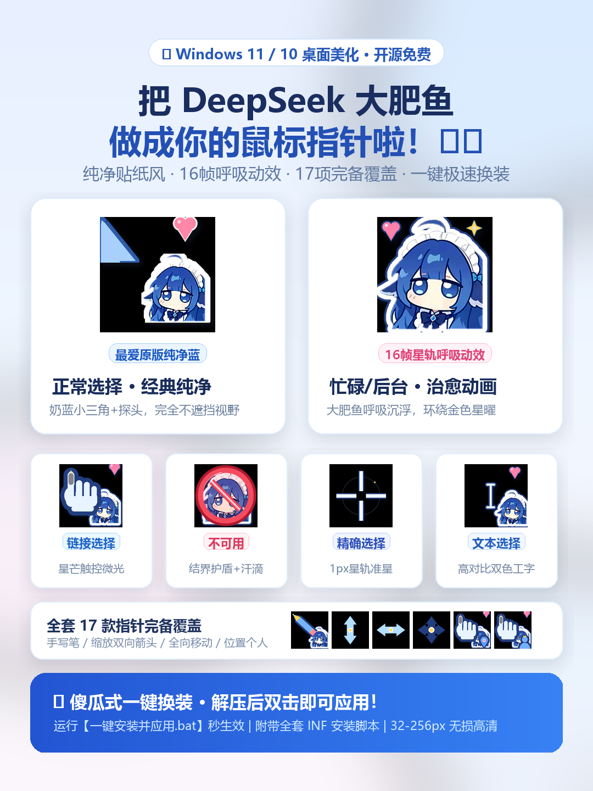

# 🐋 FeiyuCursor · 大肥鱼指针
### 把 DeepSeek 娘 (大肥鱼) 做成你的 Windows 鼠标指针！

**原汁原味奶蓝经典 · 16帧动态呼吸星轨 · 17项完备覆盖 · Windows 11 / 10 高清自适应**

 

 

---

## 🐟 为什么叫「大肥鱼指针」？

DeepSeek 官方吉祥物是一只灵动治愈的深蓝小鲸鱼。在广大开发者、极客与爱好者群体中，大家最熟悉也最亲切的爱称就是 **“大肥鱼”**（或“肥鱼娘”）。
本项目以 **“大肥鱼 (FeiyuCursor)”** 全新命名，既接地气又充满情怀，让大肥鱼在你的桌面上每天伴你摸鱼与高效工作！

---

## ✨ 核心亮点与特色

- 🎯 **正常选择保留原版经典**：采纳大家最喜爱的经典设计，温润马卡龙纯色天蓝箭头 + 大肥鱼娘贴纸探头 + 单个点缀的粉色小爱心，视觉清爽耐看，打字打游戏绝不遮挡视野！
- 💫 **【全新】16 帧丝滑动态呼吸星轨 (`.ani`)**：
  - **忙碌 (Busy)**：大肥鱼娘微幅呼吸沉浮，环绕金色星轨平滑自转，电脑加载卡顿时赏心悦目。
  - **后台运行 (AppStarting)**：箭头点击尖端保持 100% 绝对稳固，身旁金色星曜 360° 顺畅自转。
- 🛡️ **软萌不可用状态**：告别生硬粗暴的大红粗叉，改为半透明珊瑚红「水晶结界防护泡泡」+ 大肥鱼娘微汗困扰表情。
- 🔍 **专业级精确与文本选择**：
  - **精确选择**：1px 中心留空星轨准星，专业像素级定位无遮挡。
  - **文本选择**：双色高对比工字梁（深蓝抗光外廓 + 亮白内芯），在纯白文档或 VS Code 深色编辑器中均清晰显眼。
- 📱 **高颜值小红书种草宣传图**：内置精心制作的 3:4 竖屏高清种草展示海报，开箱即用。

---

## 📦 全套 17 项指针一览

| 指针文件 | 对应系统角色 | 特色说明 | 热点位置 |
|---|---|---|---|
| `feiyu_arrow.cur` | **正常选择** | 经典温润浅蓝箭头 + 探头 + 萌心 | `(0, 0)` 顶端 |
| `feiyu_hand.cur` | **链接选择** | 星芒触控手 + 指尖点击微光 | 食指尖端 |
| `feiyu_busy.ani` / `.cur` | **忙** | **【16帧动态动画】** 呼吸沉浮 + 环绕星轨 | `(居中, 居中)` |
| `feiyu_appstart.ani` / `.cur` | **后台运行** | **【16帧动态动画】** 原版稳固箭头 + 旋转星曜 | `(0, 0)` 箭头尖端 |
| `feiyu_no.cur` | **不可用** | 水晶防护结界泡泡 + 困扰微汗神态 | `(居中, 居中)` |
| `feiyu_cross.cur` | **精确选择** | 灵寻星轨准星（1px中心留空十字） | `(居中, 居中)` |
| `feiyu_ibeam.cur` | **文本选择** | 高对比双色工字梁 + 大肥鱼探头 | `(中心, 居中)` |
| `feiyu_help.cur` | **帮助选择** | 浅蓝箭头 + 浮光问号思考气泡 | `(0, 0)` 箭头尖端 |
| `feiyu_pen.cur` | **手写输入** | 灵羽数位星笔 + 笔尖星曜微芒 | 笔尖书写点 |
| `feiyu_up.cur` | **备用选择** | 垂直升腾星矢 + 探头 | `(居中, 1)` |
| `feiyu_sizens.cur` | **上下调整** | 星核胶囊垂直双向箭头 | `(居中, 居中)` |
| `feiyu_sizewe.cur` | **左右调整** | 星核胶囊水平双向箭头 | `(居中, 居中)` |
| `feiyu_sizenwse.cur` | **对角调整 1** | 星核胶囊 45° 双向箭头 | `(居中, 居中)` |
| `feiyu_sizenesw.cur` | **对角调整 2** | 星核胶囊 -45° 双向箭头 | `(居中, 居中)` |
| `feiyu_sizeall.cur` | **移动** | 星核罗盘四向移动标 | `(居中, 居中)` |
| `feiyu_pin.cur` | **位置选择** | 水晶心曜定位标 | 食指尖端 |
| `feiyu_person.cur` | **个人选择** | 萌趣金冠化身徽章 | 食指尖端 |

> 每个 `.cur` 均内置 **32 / 48 / 64 / 96 / 128 / 192 / 256px** 多档分辨率（32位透明通道），在 100%~300% 系统 DPI 缩放下自动无损匹配。

---

## 🚀 极速安装使用（Windows 10 / 11）

### 方法一：一键自动安装（最推荐）
1. 在仓库 Releases 或根目录下载 `FeiyuCursor_大肥鱼指针.zip` 并解压；
2. 双击运行 **`一键安装并应用.bat`**；
3. 脚本会自动将所有指针部署到系统目录并导入方案；
4. 随后自动弹出鼠标属性面板，方案已自动选中 **「大肥鱼指针」**，点击 **「确定」** 秒换装完成！🎉

### 方法二：经典 INF 安装
1. 右键点击 `安装鼠标指针.inf` → 选择 **「安装」**；
2. 快捷键 `Win + R` 输入 `main.cpl` 打开鼠标属性；
3. 切换到「指针」选项卡，在「方案」下拉列表中选择 **「大肥鱼指针」**；
4. 点击「确定」即可。

---

## 🎨 种草海报

  

---

## 🛠️ 自定义与二次构建

全套指针由 Python 脚本自动化构建生成（基于 Pillow、OpenCV 与 NumPy）：
- 重新构建全套指针：`python build_feiyu.py`
- 重新生成小红书海报：`python create_xhs_poster.py`

---

## 📄 开源与版权说明

- 本项目鼠标指针方案与生成脚本完全开源免费，欢迎自由分享与二创；
- DeepSeek 娘角色形象版权归 DeepSeek 官方所有，本仓库仅作为桌面个性化美化用途，请勿用于商业牟利。
