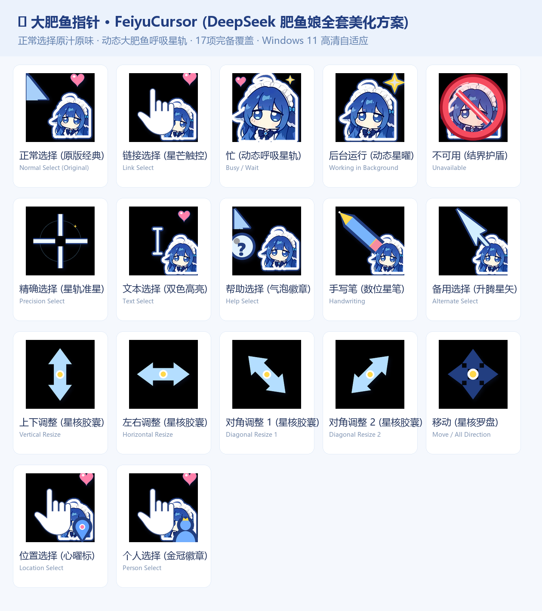

# 🐋 大肥鱼指针 · FeiyuCursor

**让大肥鱼陪你游过桌面。**

面向 Windows 10 / 11 的鼠标指针方案，覆盖 17 种指针角色，包含忙碌与后台运行两款动画。

[下载 ZIP](https://github.com/Infinite-Monkey-Lab/FeiyuCursor/raw/refs/heads/main/FeiyuCursor_大肥鱼指针.zip) · [安装步骤](#安装与应用) · [恢复默认](#恢复默认指针) · [生成源码](build_feiyu.py) · [素材许可](LICENSE-SCOPE.md)

天蓝箭头、角色贴图与星轨细节组成整套视觉风格。静态指针使用 `.cur`，忙碌和后台运行使用 16 帧 `.ani` 动画，并附静态版本。

## 安装与应用

### 推荐：一键安装

1. [下载 ZIP 包](https://github.com/Infinite-Monkey-Lab/FeiyuCursor/raw/refs/heads/main/FeiyuCursor_大肥鱼指针.zip)，**先完整解压**，让脚本与指针文件保持在同一目录。
2. 双击 `一键安装并应用.bat`。
3. 在随后打开的鼠标属性窗口中，切到“指针”，选择 **大肥鱼指针**，点击“应用”或“确定”。

普通用户即可运行仓库中的安装脚本。它将文件复制到 `%LOCALAPPDATA%\Cursors\FeiyuCursor`，注册当前用户的指针方案；检测到管理员权限时，还会尝试同步副本到系统指针目录。

### 备选：INF 安装

右键 `安装鼠标指针.inf`，选择“安装”，随后按 <kbd>Win</kbd> + <kbd>R</kbd> 输入 `main.cpl`，在“指针”选项卡中选择“大肥鱼指针”并应用。Windows 11 可能需要先点“显示更多选项”。

## 设计与细节

| 指针场景 | 设计 |
| :--- | :--- |
| 正常选择 | 天蓝箭头、探头角色与粉色爱心 |
| 忙碌 | 角色轻微浮动，搭配环绕星轨与爱心动画 |
| 后台运行 | 保持箭头尖端位置稳定，旁侧星曜旋转 |
| 文本选择 | 深蓝轮廓与亮白内芯的工字指针 |
| 精确选择 | 中心留空的十字准星与星轨装饰 |
| 不可用 | 护盾造型与角色表情 |
| 调整大小与移动 | 双向箭头及四向造型，保持整套配色一致 |

静态指针包含 32–256 px 多尺寸位图。实际显示大小与清晰度取决于 Windows 指针设置和屏幕缩放。

展开查看完整的 17 项指针文件

| Windows 指针角色 | 文件 |
| :--- | :--- |
| 正常选择 | `feiyu_arrow.cur` |
| 帮助选择 | `feiyu_help.cur` |
| 后台运行 | `feiyu_appstart.ani`，附 `.cur` 静态版 |
| 忙 | `feiyu_busy.ani`，附 `.cur` 静态版 |
| 精确选择 | `feiyu_cross.cur` |
| 文本选择 | `feiyu_ibeam.cur` |
| 手写 | `feiyu_pen.cur` |
| 不可用 | `feiyu_no.cur` |
| 垂直调整大小 | `feiyu_sizens.cur` |
| 水平调整大小 | `feiyu_sizewe.cur` |
| 沿对角线调整大小 1 | `feiyu_sizenwse.cur` |
| 沿对角线调整大小 2 | `feiyu_sizenesw.cur` |
| 移动 | `feiyu_sizeall.cur` |
| 候选 | `feiyu_up.cur` |
| 链接选择 | `feiyu_hand.cur` |
| 位置选择 | `feiyu_pin.cur` |
| 人员选择 | `feiyu_person.cur` |

## 恢复默认指针

按 <kbd>Win</kbd> + <kbd>R</kbd>，输入 `main.cpl` 打开鼠标属性。在“指针”选项卡中选择 Windows 默认方案并应用，即可切换回系统指针，无需重新安装系统组件。

## 常见问题

**运行脚本后没有变化？**

打开 `main.cpl`，确认在“指针”选项卡中选中了“大肥鱼指针”，再点“应用”。

**找不到方案，或者提示找不到文件？**

确认已经解压完整下载包，脚本旁有 `feiyu_*.cur` 和 `feiyu_*.ani` 文件，再重新运行安装脚本。不要只下载或单独移动 `.bat` 文件。

**不想使用动画？**

在“指针”选项卡中分别选择“忙”和“后台运行”，点击“浏览”，改用对应的 `feiyu_busy.cur` 与 `feiyu_appstart.cur`，再应用。

## 源码与反馈

[build_feiyu.py](build_feiyu.py) 提供指针绘制、静态文件与动画生成逻辑，适合查看颜色、形状和动画的实现。安装与使用现成指针不需要 Python。

发现显示或安装问题，欢迎提交 [Issue](https://github.com/Infinite-Monkey-Lab/FeiyuCursor/issues)，附上 Windows 版本、缩放比例、问题截图与复现步骤。

## 许可与素材

原创程序代码和说明文档采用 [MIT License](LICENSE)，Copyright (c) 2026 yunyancuo。

角色图片、预览图、生成的指针及内嵌第三方图像**不自动纳入代码的 MIT 授权**。角色来源和素材授权范围以 [LICENSE-SCOPE.md](LICENSE-SCOPE.md) 为准；本项目不代表 DeepSeek 或 Windows 官方认可。

下载包是代码、文档与素材的合集。再分发时应保留 `LICENSE` 和 `LICENSE-SCOPE.md`，并分别核实所用素材的授权。

由 [Infinite Monkey Lab](https://github.com/Infinite-Monkey-Lab) 维护。
